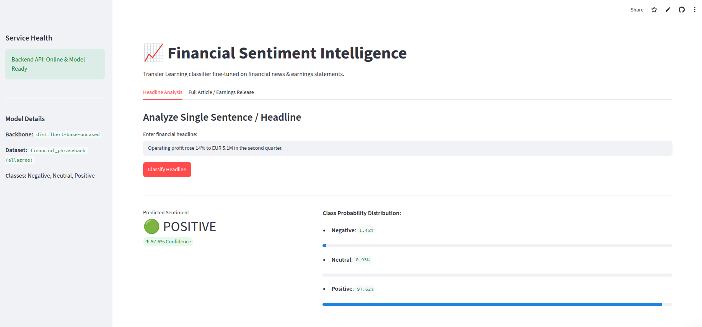
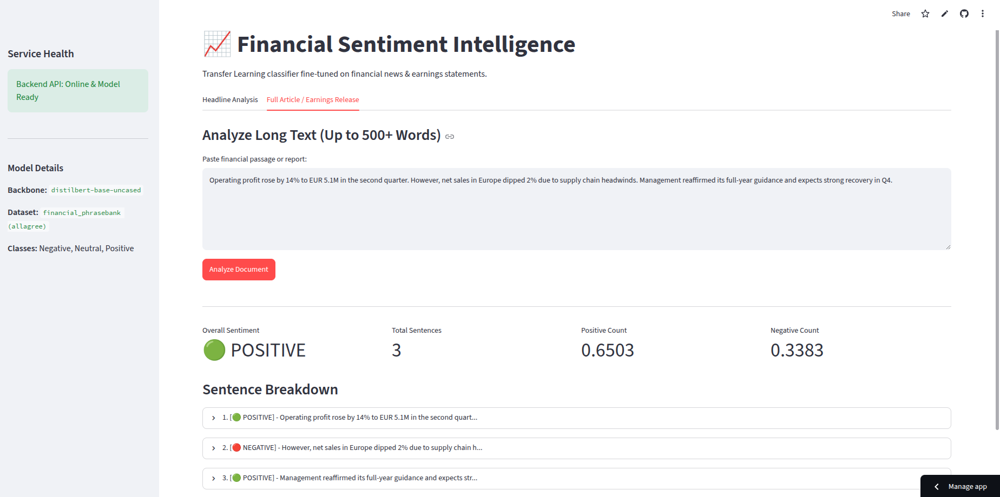

# 📈 Financial Sentiment Intelligence

[](https://fastapi.tiangolo.com/)
[](https://streamlit.io/)
[](https://huggingface.co/)
[](https://onnxruntime.ai/)

An end-to-end NLP transfer learning service designed to classify financial headlines, earnings releases, and market commentary into **Positive**, **Neutral**, or **Negative** sentiment with calibrated confidence scores.

The platform fine-tunes a `distilbert-base-uncased` transformer on the Financial PhraseBank dataset, exports it to a quantized ONNX model, and serves predictions via a decoupled **FastAPI** inference backend and an interactive **Streamlit** dashboard.

**🔗 [Access the Live Web Dashboard Here](https://financial-sentiments-classifier-xtvnii4xl5tjjne7t6ktxf.streamlit.app/)**


*Caption: Real-time financial headline sentiment classification with calibrated probability distribution.*


*Caption: Multi-sentence financial document breakdown with sentence-level tagging and overall sentiment aggregation.*


---

## ⚡ Key Features

- **Domain-Adapted Transfer Learning:** Fine-tuned `distilbert-base-uncased` on financial domain texts to detect nuance in earnings reports and regulatory filings.
- **Lightweight ONNX Inference:** Serves a quantized ONNX model through ONNX Runtime on CPU — no PyTorch needed at inference time.
- **REST API:** FastAPI endpoints with structured Pydantic schemas, health checks, and sub-second inference latency.
- **Document-Level Aggregation:** Analyzes long-form financial passages sentence-by-sentence to produce an overall document sentiment score alongside individual breakdowns.
- **Interactive Web Interface:** Streamlit-powered dashboard featuring visual confidence metrics, class probability bars, and expandable sentence explorers.

---

## 🏗️ System Architecture

The training pipeline is kept separate from inference, so the serving stack only needs the lightweight runtime dependencies.

```text
[Financial Text / Market News]
               │
               ▼
┌──────────────────────────────┐
│     Streamlit Dashboard      │ ── (Web UI Port 8501)
└──────────────┬───────────────┘
               │
               │ HTTP POST /predict  (API_URL, default http://localhost:8000)
               ▼
┌──────────────────────────────┐
│     FastAPI Serving API      │ ── (REST Engine Port 8000)
│   ├── Pydantic Input Guard   │
│   ├── ONNX Runtime Session   │
│   └── Multi-Sentence Parser  │
└──────────────┬───────────────┘
               │
               ▼ (Reads quantized ONNX model & tokenizer)
┌──────────────────────────────┐
│   Trained Model Artifacts    │
│ (artifacts/final_model/onnx) │
└──────────────────────────────┘
```

---

## 📁 Repository Structure

```text
├── artifacts/
│   └── final_model/
│       └── onnx/             # Quantized ONNX model, tokenizer & config (included)
├── assets/images/            # README screenshots
├── src/
│   ├── api/
│   │   ├── main.py           # FastAPI entrypoint & lifecycle hooks
│   │   ├── route.py          # API route definitions (/health, /predict)
│   │   ├── schemas.py        # Pydantic request/response validation
│   │   └── service.py        # Predictor singleton service wrapper
│   ├── app_ui.py             # Streamlit visual dashboard
│   ├── config.py             # Centralized paths and hyperparameters
│   ├── dataset_loader.py     # Dataset preprocessing & tokenization
│   ├── export_onnx.py        # Export & quantize the trained model to ONNX
│   ├── metrics.py            # Evaluation metrics
│   ├── predict.py            # ONNX inference engine & sentence tokenizer
│   └── train.py              # Transfer learning fine-tuning script
├── tests/                    # Pytest unit and integration test suite
├── Makefile                  # Dev lifecycle shortcuts (macOS / Linux)
├── requirements.txt          # Runtime (inference) dependencies
└── requirements-dev.txt      # Training, testing, and dev tools
```

---

## 🚀 How to Run Locally

A pre-trained quantized model is already included in `artifacts/final_model/onnx/`, so you can run the API and dashboard straight away — training is optional.

### 1. Create a Virtual Environment & Install Dependencies

**Windows (PowerShell):**

```powershell
python -m venv .venv
.venv\Scripts\Activate.ps1
python -m pip install --upgrade pip
pip install -r requirements.txt        # inference only
# or: pip install -r requirements-dev.txt   # + training, tests & tooling
```

**macOS / Linux:**

```bash
python3 -m venv .venv
source .venv/bin/activate
make install        # inference only
# or: make install-dev   # + training, tests & tooling
```

### 2. Start the Services

Run each in its own terminal (with the virtual environment activated), from the project root:

```bash
# Terminal 1: FastAPI backend (port 8000)
uvicorn src.api.main:app --host 0.0.0.0 --port 8000 --reload     # or: make serve

# Terminal 2: Streamlit dashboard (port 8501)
streamlit run src/app_ui.py --server.port 8501                   # or: make ui
```

* **Interactive API Documentation:** [http://localhost:8000/docs](http://localhost:8000/docs)
* **Streamlit Analytics Dashboard:** [http://localhost:8501](http://localhost:8501)

If the API runs somewhere other than `http://localhost:8000`, point the dashboard at it with the `API_URL` environment variable before starting Streamlit.

### 3. (Optional) Train the Model

Requires `requirements-dev.txt`. Fine-tunes the classifier and writes weights to `artifacts/final_model/`:

```bash
python -m src.train        # or: make train
```

Then export and quantize it to ONNX for serving (needs Hugging Face Optimum, which isn't in the requirements files):

```bash
pip install "optimum[onnxruntime]"
python src/export_onnx.py
```

### 4. Run the Test Suite

Requires `requirements-dev.txt`:

```bash
pytest tests/ -v --cov=src     # or: make test
```

> **Note:** The `make` commands assume a Unix-like shell. On Windows, use the plain commands shown alongside them.

---

## 📡 API Reference

### Health Status

```http
GET /health
```

```json
{
  "status": "healthy",
  "model_loaded": true
}
```

### Single Sentence Prediction

```http
POST /predict
Content-Type: application/json

{
  "sentence": "Operating profit rose 14% to EUR 5.1M in the second quarter."
}
```

```json
{
  "sentence": "Operating profit rose 14% to EUR 5.1M in the second quarter.",
  "sentiment": "positive",
  "confidence": 0.9842,
  "probabilities": {
    "negative": 0.0051,
    "neutral": 0.0107,
    "positive": 0.9842
  }
}
```

### Document Sentiment Breakdown

```http
POST /predict-document
Content-Type: application/json

{
  "text": "Operating profit rose 14%. However, sales dipped 2% in overseas markets."
}
```

---

## 📄 License

This project is open-source and distributed under the MIT License.
